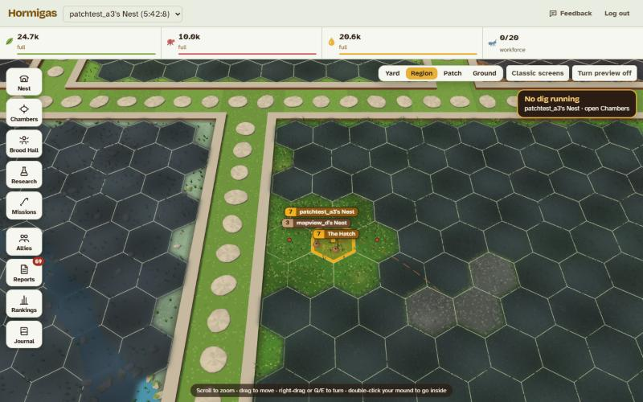

# 22 — Scents and Discovery

**Version:** 0.1
**Code:** `shared/src/discovery.ts` (rules), `server/src/game/discovery.ts` (the record), migration `008_known_colonies.sql`; fog of war in `shared/src/fog.ts`, `server/src/game/fog.ts`, migration `016_fog_of_war.sql`

## Why
Two playtest notes from Marz (29 Oct 2026): the map was hard to read, and anyone could raid a colony they had never seen by typing its coordinates. Hormigas now works like discovery in Civilization: **you have to meet someone before you can deal with them**. Ants find each other by smell, so a colony you haven't met is a **scent**.

This is also the foundation for later builds. More NPCs ([#67](https://github.com/MarcialPimentel/hormigas/issues/67)) start out undiscovered, and alliances ([#68](https://github.com/MarcialPimentel/hormigas/issues/68)) begin with first contact. Both read the same record described below rather than inventing their own.

## What a player knows about a colony
Every colony you don't own is, to you, one of three things:

| Level | How you get there | What you see | What you can do |
|---|---|---|---|
| **Scent** | Default | A scent plume on its spot: **amber = another player's ants**, **red = wild ants**. Nothing else: no name, owner, points, species or level. | Scout it |
| **Familiar scent** | It scouted or raided one of your colonies | The scent plus its name and owner, and when it came at you ("I've smelled this scent before") | Scout it |
| **Known** | You scouted it | Everything the map showed before: name, owner, points, protection, nest species and level, your latest scout report | Scout, Raid, Send |

- **Scout before you raid or send.** A raid or transport to a scent is refused with the reason: "Scout this scent first. Your soldiers need to know what they're walking into." The Raid and Send buttons on a scent are greyed out and say the same.
- **Scouting is always allowed**, including scouting a scent. A scout report makes the colony known even if the scouts are caught: they saw enough to come back with a report.
- **Discovery is one way.** Being scouted or raided doesn't make the attacker known to you. It makes the attacker's colony a *familiar* scent: you learn who came, but you still scout before striking back.
- **Known is forever.** A colony never goes back to being a scent. How fresh your view is shows as the age of your latest scout report.
- **Your own colonies** are always known.
- **Wild nests** follow the same rules: the nest in your patch starts as a red scent, and the founding tasks already ask you to scout it before raiding it.
- **Army-ant swarms** don't count: they have no home to remember.
- Scents show on every patch, so players can still find each other. Only scouting reveals who's there.

## Fog of war
Added 2 Nov 2026 (Marz: "treat it like Civilization, except players should know the outlines"). Scents say *who* is in a patch; fog says whether you can see the patch at all. Every patch is, to you, one of three things:

| State | Which patches | What you see |
|---|---|---|
| **In sight** | Patches with your colonies and the patches touching them, and patches where your ants are stationed: soldiers holding an ally's colony, ants tending an aphid herd or holding a windfall. Supercolony mates share their sight | Everything, as before fog |
| **Explored** (out of sight) | A patch your ants have reached before | As you last saw it, greyed: the colonies that were there then (scents or known, by the usual rules), and nothing that comes and goes (windfalls, corpse fields, parties). A colony founded since stays hidden until you look again |
| **Never explored** | Everything else | Only the patch's outline and its region's ground, under mist, plus its wilds so you can send Scouts |

- **Exploring:** any party of yours that reaches a patch explores it, last seen at the moment it arrives. To just go and look, **Scout the patch's wilds** (spot 13); Scouts and foragers are the only ones who may go to a patch you've never explored. Anything else there (a raid, a transport, founding a colony, scouting a particular spot) is refused: "You haven't explored that patch yet. Send Scouts to survey its wilds first."
- **Touching patches** are the hexes next to a patch inside its region, as the Whole Yard draws them: rows of 10, odd rows shifted right (`patchNeighbours` in `shared/src/fog.ts`). Regions don't share neighbours: crossing to another region is still a long trip.
- **Explored is forever** (like known): a patch never goes back to never-explored. Supercolony mates share their explored patches as well as their sight.
- **The server enforces it** for every screen: the patch (`/api/map`, with `fog` and `seenAt`), the region grid and the Garden (`/api/map/region`: counts only for explored patches, as last seen, plus each patch's `fog`), and the Nearest buttons (`/api/map/nearest`: explored patches only). Phones and the classic screens see exactly what the Whole Yard sees.
- Incoming raids and scouts are still announced as before, wherever they come from.
- **On the live world (migration 016):** everyone keeps what they had already seen, as it is now: every patch their ants had reached, and every patch holding a colony they had scouted. Patches round their own colonies are always in sight.

- **The record:** `explored_patches (player_id, region, patch, seen_at)`, written only through `server/src/game/fog.ts` (`explore`, `sightOf`, `fogOf`, `requireExploredFor`).

## The shared record (for other builds)
One table, `known_colonies`, one row per player and colony they know anything about:

| Column | Meaning |
|---|---|
| `player_id`, `colony_id` | Who knows which colony (primary key) |
| `via` | How it was first recorded: `scouted`, `earlier` (seeded at launch), `scouted_you`, `raided_you`. Later builds add their own values (e.g. `contact`, `ally`) |
| `first_at` | When the row was created |
| `discovered_at` | Set once the player has scouted it: the colony is **known**. Never cleared |
| `smelled_at` | The last time it scouted or raided one of the player's colonies: **familiar** if not yet known |

No row means a scent. Rows are never deleted. Colonies are never destroyed (pillar 2), so a row never dangles.

**Read and write it only through `server/src/game/discovery.ts`:**
- `knowledgeOf(q, playerId, colonyIds)` and `knowledgeOne(...)` return `'mine' | 'known' | 'familiar' | 'scent'` per colony.
- `discover(q, playerId, colonyId, via, at)` makes a colony known.
- `smelledBy(q, playerId, colonyId, via, at)` records that a colony came at the player.
- `requireKnown(q, playerId, colonyId, 'raid' | 'send')` throws the player-facing reason.

The map API (`/api/map`) sends each colony with `known` and `kind` (`'player' | 'wild'`). For a scent it sends only those plus a generic name ("Ant scent", "Wild scent"). The client draws a scent for `known` = `scent` or `familiar`.

### Notes for the next builds
- **NPCs (#67, done in Build 9):** new NPCs are ordinary colony rows owned by the hidden wild player, so scouting, raiding and discovery work with no new rules. Aphid herds, termite mounds and spider dens sit on new **wild sites** (spots 14–16), and wild scents carry a hint: sharp, sweet, woody or danger ([24-npcs](24-npcs.md)). Tending a herd needs a scouted herd, like a raid.
- **Alliances (#68), built:** contact = *either* side has scouted the other ([23-supercolonies](23-supercolonies.md)). Sharing a supercolony's scent records each other's colonies with `via = 'ally'`. Truces and supercolonies live in their own tables.

## Where it shows
- **Missions tab:** your patch is drawn at the top. Tap a scent or colony, then Scout / Raid / Send. The send form names the target and flags a scent. The old Map tab is folded in: **World** opens the region grid to look at other patches ([11-world](11-world.md#missions-screen-the-patch-and-the-world)).
- **Founding tasks:** "Send out a Scout" and "Raid the wild nest" point at the red scent.
- Reports, incoming-raid warnings and rankings are unchanged: they already named the colonies involved.

## Launch on the live world (migration 008)
- New table only. No existing row changes.
- Colonies a player had already **scouted or raided** become known (`via = earlier`).
- Colonies that had **scouted or raided the player** become familiar scents.
- Everything else becomes a scent, including the wild nest in your patch if you never scouted or raided it.

## Decisions (Marz, 29 Oct 2026)
- **Missions shows your patch; the Map tab folds into it.** One tab instead of two, and no typing coordinates to pick a target (the coordinates box is still there, tucked away).
- **Scents tell players and NPCs apart:** amber for players, red for wild ants.
- **No raiding a scent.** Transport (Send) also needs a scouted target.
- **Discovery is one way, but you recognize who smelled you.** Being scouted or raided shows the attacker's name on your map; you still scout before raiding back.
- **Already known at launch:** colonies you scouted or raided. Colonies that came at you become familiar, to match the one-way rule.
- **Players are placed together:** see [11-world](11-world.md#starting-placement).

## Open Questions
- ~~Should scents in far-off patches be hidden too (fog)?~~ Yes: fog of war, 2 Nov 2026 (see above).
- Should a scout's whole route explore the patches it walks through, not only its target? Proposal: later, once routes are drawn across patches on the map.
- Should a very old scout report fade the colony back to "familiar"? Proposal: no. The report's age already says how stale it is.
