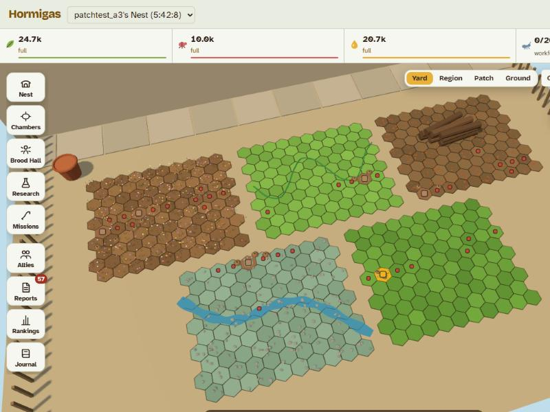
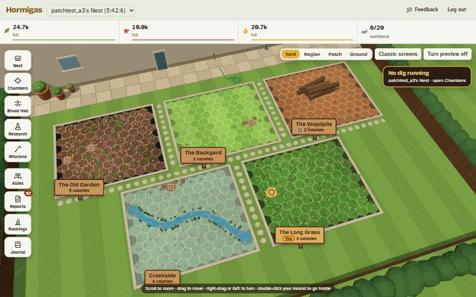
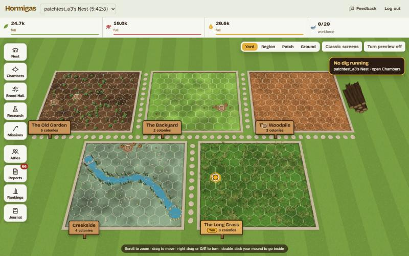
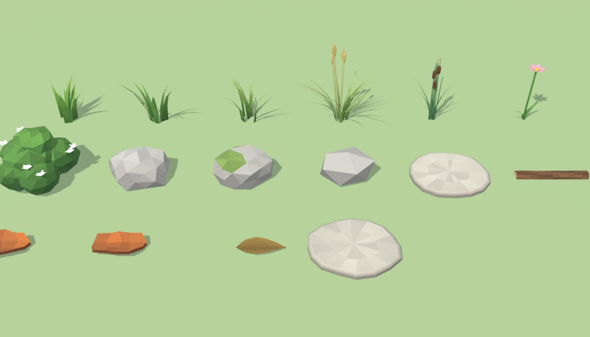
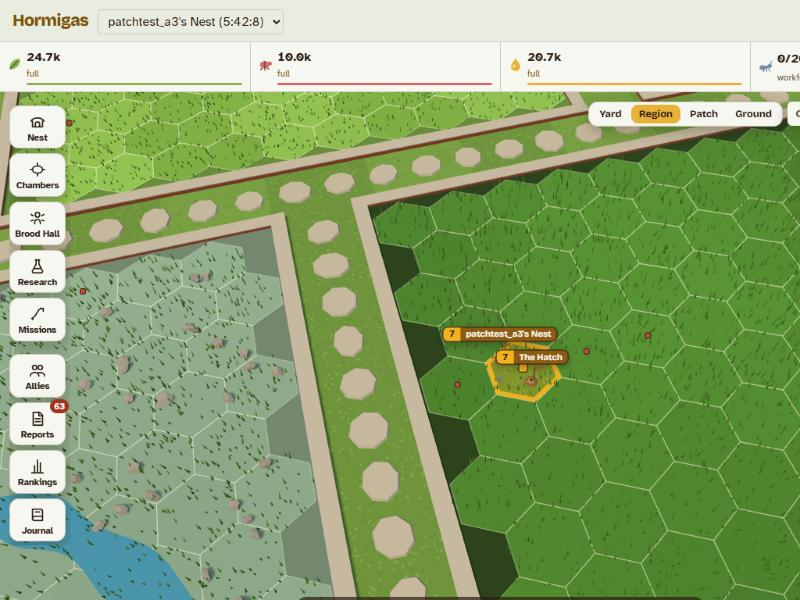
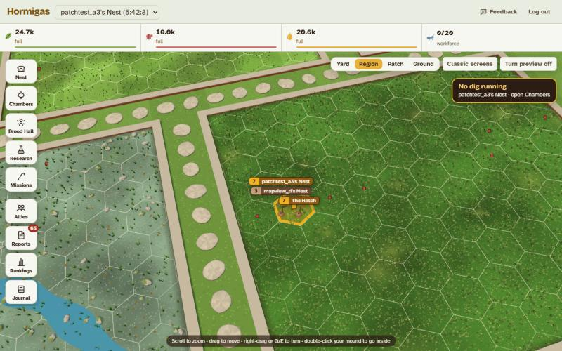
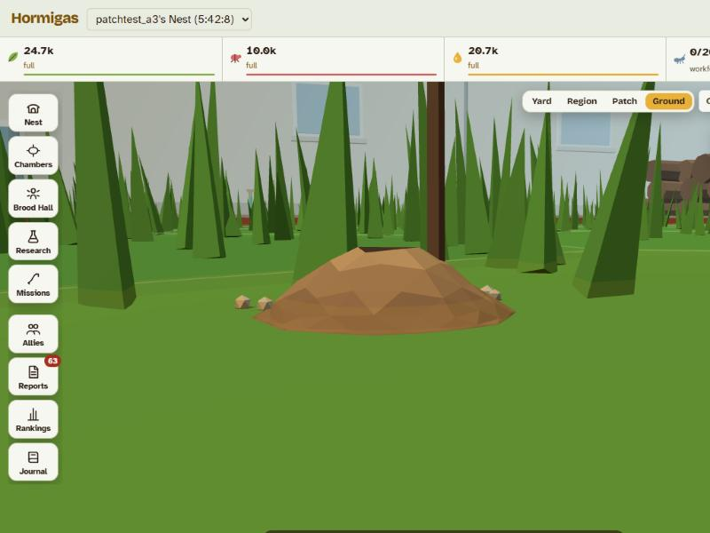
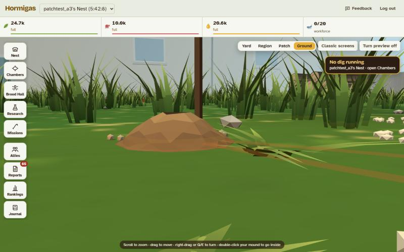

# The Whole Yard: Hormigas as a 3D 4X on one map

**Status:** the only view on computers since 4 Nov 2026 (the `?preview=yard` switch and the classic screens are gone there; phones keep the classic screens). Approved as a preview, 1 Nov 2026: Marz asked to ship it behind a switch to playtest, with Chambers, Brood Hall and Research as panels over the map and phones left on today's screens. Built in `client/src/screens/Yard.tsx` and `client/src/components/yard3d/scene.ts`. Parties walk their path with the code the 3D Patch uses (`client/src/components/three/path.ts`), so a fix there reaches both; the rest of each scene (ground, mounds, camera) is still its own copy. Mist became fog of war on 2 Nov 2026 ([22-discovery](../22-discovery.md#fog-of-war)); border bonuses are still open.
**Mock-up:** [whole-yard-mockup.html](whole-yard-mockup.html) (open in a browser; published as "Hormigas Whole Yard"). Sources in [whole-yard/](whole-yard/): edit `page.src.html` and `scene.js`, then run `python docs/art/whole-yard/build.py`. The mounds come from a Blender script: `"C:/Program Files/Blender Foundation/Blender 5.2/blender.exe" -b -P docs/art/whole-yard/mounds.blend.py` writes `mounds.json` and `mounds-preview.png`. (The game itself now draws the Meshy colony mound, `art/meshy/colony-mound/`.)

Builds on [sunlit-microcosm.md](sunlit-microcosm.md) (the scale ladder, approved 30 Oct) and the cartoon ants (#123). Palette and type are unchanged.

## The short version

| | Call |
|---|---|
| Structure | **One map, one zoom:** Yard (the five beds) → Region (≈5 m) → Patch (≈1 m) → Ground (≈6 cm), on one screen. Double-click your mound to dive into the nest. |
| Look | **Civilization's map grammar:** patches as hex tiles far out, scent borders, mist over unexplored ground, mounds that grow, banners, a "Needs you" button. |
| Rules | **Civ's look, OGame's clock.** No turns, no unit micro, nothing about the server rules changes. |
| Technology | Grow the Three.js Garden and Patch scenes into one scene with level-of-detail rules; the nest stays its own scene, joined by the dive. |
| Art | A scripted Blender kit: mounds in three growth stages (done), landmarks, region dressing, the master ant. |
| Playtest | A preview switch on the live game (`?preview=yard`), off for players, so Marz plays it with his real colonies before anyone else sees it. |

## What makes it read as a 4X

| Civilization | Hormigas, Whole Yard | Cost |
|---|---|---|
| Hex map | Each patch is a hex tile (5 regions × 100). The grid shows far out and fades up close. | Art only |
| Cities that grow | Mounds in three stages by colony points (heap → thatched → big domed mound). | Art only |
| City banners | Level, name, ant count; "!" on wild nests; coloured squares far out. | Art only (data exists) |
| Culture borders | Scent borders: honey yours, teal supercolony mates, muted brown rivals, red wild. | Art only; a border bonus would be a new rule |
| Fog of war | Mist over patches you have never scouted or sent ants to. | Small server change: patches seen per player |
| Units | Columns of real ants close up, a tag in between, a thread far out. | Exists (#92, #96); joined up |
| Strategic view | Zooming out is the strategic view. | Art only |
| End turn | **Needs you**: idle Brood Hall, no dig, raid incoming; tap and the map flies there. | Art only |
| City screen | The dive through the crater into the 3D nest. | Exists; joined by the dive |
| Wonders | Later idea: landmarks as contested places ([#145](https://github.com/MarcialPimentel/hormigas/issues/145), [27-living-world](../27-living-world.md#4-landmarks)). | New system, not proposed now |

**Recommendation on rules:** take Civilization's presentation, not its rules. Turns, settlers and moving units by hand break "the colony lives while you're away" and "no unit micro", and turn a 5-minute check-in into a long session.

## Conflicts with the design docs

| Doc | Says today | Would say |
|---|---|---|
| 00-vision · Inspirations | Browser strategy, idle games, ant biology | Adds Civilization's map (presentation only) |
| 00-vision · Tone | Grounded documentary, "no cartoon faces" | Stylised field guide (cartoon ants with eyes are live since #123) |
| 18-art-direction · Decision 1 | Separate rungs: Garden, Patch, Nest, Chamber | One continuous map Yard → Ground; nest joined by a dive |
| 11-world · Missions screen | The map lives in Missions | The map is the main screen; Colony and Missions become cards on it |
| 11-world · Coordinates | Patches in a 10 × 10 grid | Same numbers drawn as offset hex tiles (travel times unchanged) |
| 22-discovery | Unscouted colonies are scents | Plus mist over patches never seen |

## Plan

1. Preview switch and the one zoom (computers, existing art): Garden + Patch become one map behind `?preview=yard`; double-click your mound dives into the 3D nest.
2. Civ grammar: hex tiles far out, scent borders, banners, Needs you.
3. Mist: the server keeps the patches each player has seen; scouting lifts it.
4. Blender kit: growing mounds, landmarks, region dressing, the master ant.
5. Make it the main screen for everyone (Marz's call after playtests), then phones.

## The Yard view

The top zoom (approved 1 Nov 2026, option 2 of three previews; built in `yard3d/scene.ts`):

 

- **A tidy garden seen from upstairs.** A lawn mown in stripes, the five beds 1.5 m apart (drawing only: travel times don't change), each with a low brick edge and a pale coping, stepping stones across the lawn between them.
- **Every bed its own ground:** striped lawn (The Backyard), dark soil with flower clumps (The Old Garden), mossy bank with the creek running from a spring pool to a pond and reeds (Creekside), orange bark chips with the log pile (The Woodpile), deep green with tussocks and straw seed heads (The Long Grass). The big clumps, reeds and tussocks only show from the top; closer in, the real grass and flowers take over.
- **A sign per bed:** a wooden plant marker with the bed's name and how many colonies live there; beds where you live are brighter and say **You**. Click one to fly to that bed.
- **Markers:** your colony is a honey pin with a slow pulse (still with motion off); allies and rivals get a cream ring so they read on any bed; wild nests shrink to faint specks from the top and come back at Region.
- **Hex lines** are thin cream lines, not dark ones.
- **Just the beds (2 Nov 2026):** the top view fits the five beds and their signs to the window, and you can't pull back further. The house, patio, pots, hose, fence and hedge are gone (Marz: the fake building and the huge top level weren't needed); striped lawn runs out to the horizon. The Woodpile's logs are stacked on the lawn beside its bed, so they never hide a patch.

## The models

Every zoom's ground and plants (approved 2 Nov 2026; Marz picked soft ground with a drawn grid, curved grass clumps, and Blender versions of the rocks, stones, flowers, shrubs, logs, bark, reeds and tussocks):

 

 

- **No more hex slabs.** Each bed is one continuous ground, painted at about 1 px per cm with its own surface: mown stripes, dark crumbly soil, mossy bank with gravel, orange bark chips, long grass with dry patches, and a damp shaded rim inside the brick edge. The hexes are only the thin lines drawn on top, strong far out and fading up close.
- **Grass is clumps of curved blades**, dark at the root and light at the tip, that sway in the wind (still with motion off): short on the lawn and among the bark chips, medium in the flowerbed and on the creek bank, tall in the Long Grass, each bed's tinted to its ground. Close in, grass round the spot you look at and round the camera lies down, so no clump fills the screen.
- **Built in Blender** by `docs/art/whole-yard/props.blend.py` (run it the same way as the mound script). It writes `client/src/components/yard3d/props.json` (18 models, about 2,350 triangles in all) and the preview sheet above. The game draws thousands of copies of each.
- **The rest:** garden flowers on stems with coloured petals; flowering shrubs; weathered rocks (one mossy) round the creek, its pools and the litter; irregular stepping stones; ridged logs with ringed ends; curled bark chips; fallen leaves; creek reeds with cattails; Long Grass tussocks with straw seed heads. A free spot is a ring of pale pebbles, not flat white hexagons.
- **Busy columns (4 Nov 2026):** a mission draws far more ants than it sends, so a trail reads like a stream of ants: about `10 × √(party size)`, at least 10 and at most 240 (swarms 40 to 400). 3 Workers show as about 17 ants, 170 as about 130. They walk **single file, nose to tail** (Marz tried a wide stream up to four abreast and kept the single file), and a column never covers more than about 60% of its trail: on a short trail, or far out where ants are drawn big, it shows fewer. The numbers are knobs in `client/src/components/three/march.json` (density, minAnts, maxAnts, trailShare, spacing), live-tunable in the test scene (`/?test`). The label keeps the real count, and the rules don't change (Marz: "it feels empty with only 3 ants on screen"). Before, a party showed 3 to 60 ants in single file.
- **Ants grow as you pull back:** true size at ant height, about 7× at the Patch zoom and up to 25× further out (2 Nov: 3× was still too small), so a column reads like a unit on the map; they show until the Region zoom. Only the drawing changes.

## Decisions for Marz

1. Direction: the Whole Yard (Civ's look, today's rules and clock)?
2. Hex tiles: grid far out only, fading up close (recommended), or hexes at every zoom?
3. ~~Mist: fog of war over never-seen patches?~~ Done, 2 Nov 2026, for every player and screen: in sight round your colonies, explored patches greyed as last seen, never-explored patches under a dark drifting mist with only their outlines ([22-discovery](../22-discovery.md#fog-of-war)). The beds stay separate: joining them would make border patches look like neighbours when crossing regions is a long trip (Marz).
4. Scent borders: art only for now (recommended), or a bonus for owned ground later?
5. Playtest path: preview switch on the live game for your browser only (recommended)?
6. Phones: computers first; phones keep today's screens until step 5 (recommended)?
7. Tone: change "no cartoon faces" to "stylised field guide" to match the shipped ants?
